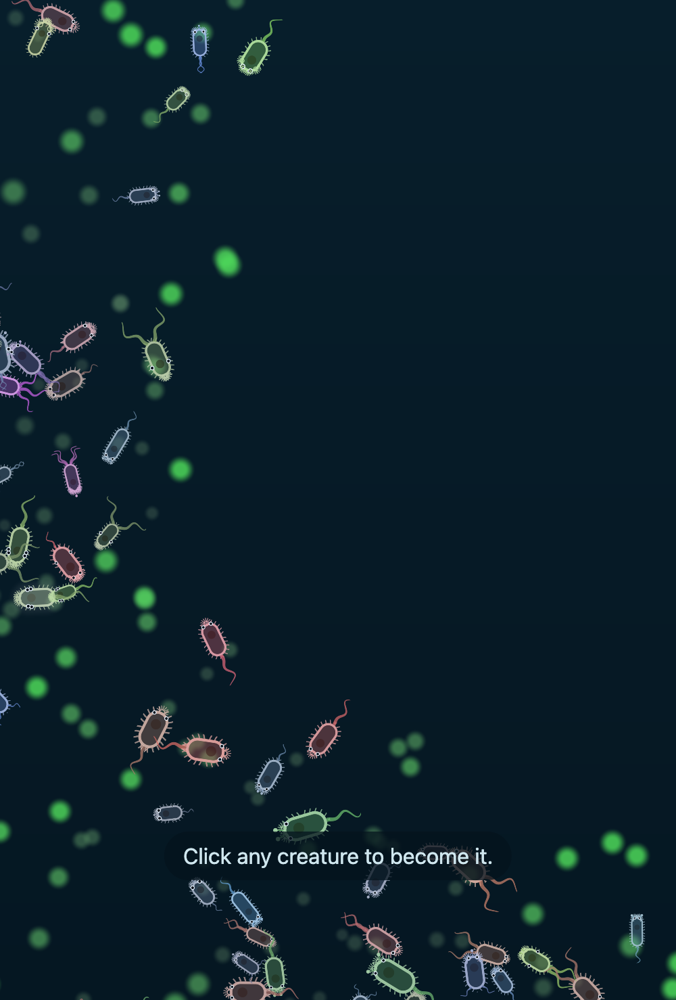
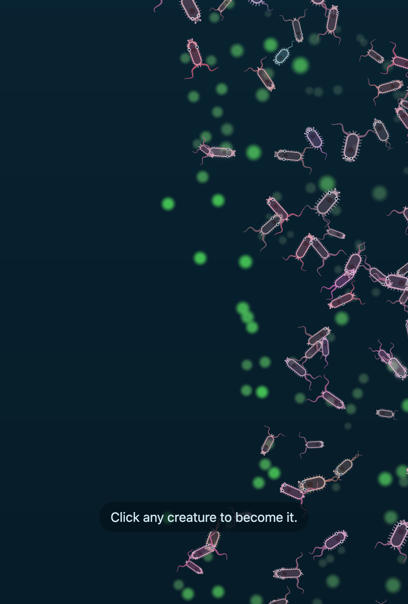
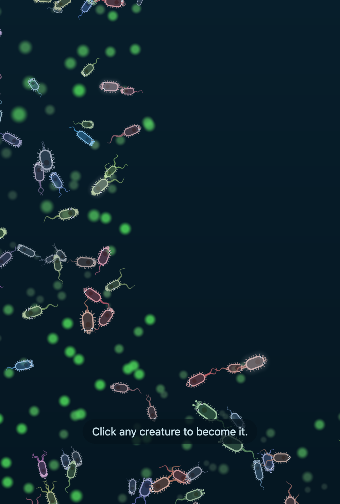

# M2 exit record

Date: 2026-10-12. Task 14 of `docs/plans/2026-10-11-m2-bodies.md`. Written by the orchestrator of the
build. Every row here was run by the orchestrator at the head, on the reference machine (Apple M4
Pro).

## Verdict

**What a machine can check is met, with the limits below. The owner's checks are open.**

The roadmap's M2 exit: "after a long headless run, creatures in one world visibly differ in body plan,
and the difference changes how they move and what they see. Part count does not collapse to the minimum
(risk R1)."

| Clause | State | Evidence |
|---|---|---|
| Creatures in one world differ in body plan | Met for a machine. "Visibly" is the owner's check 1 | `probe-plans` at tick 36,000: 54, 45, and 31 plans on seeds 1, 2, 3. The commonest plan holds 35%, 31%, 63% |
| The difference changes how they move and what they see | Met as "the mechanism fires" | The five commonest plans of a seed read top speeds from 0.55 to 1.22 and eye angles from 1.66 to 6.32. Tests of each rule: `m2-audit-fixes.md` |
| Part count does not collapse (R1) | Met to tick 144,000 on 10 seeds, one run per seed | `parts` 5.5 to 9.6. The chemoreceptor reads 0.16 to 0.27 and the eye 0.25 to 0.31. No body is without a sense |

The first audit of M2 (`m2-audit.md`, at commit f5b7381) said the exit was not met: by tick 144,000
evolution had removed the chemoreceptor on 6 of 10 seeds and both senses on one. The cause was the
upkeep of a part. On 2026-10-12 the owner deleted that rule and the food was cut to hold the count
(`m2-senses.md`). The rows below are after that change. **No fresh-context audit has run since the
change.**

## Gates

`make check` exits 0. `make gates` exits 0, for the first time in M2.

```
bench creatures=1320 median_tps=3411 floor=2400 PASS
bench-wasm creatures=1320 median_tps=3127 floor=2400 PASS
seed=1 creatures=1319 min_late=1252 plants=2229 births_late=1802 max_gen=14 mean_chemo=0.48 parked=0.00 first_bud=916 juv_starved=0.52 to_bud=0.32 PASS
seed=2 creatures=1253 min_late=1186 plants=2076 births_late=1709 max_gen=16 mean_chemo=0.43 parked=0.00 first_bud=867 juv_starved=0.50 to_bud=0.33 PASS
seed=3 creatures=1243 min_late=1133 plants=1965 births_late=1670 max_gen=14 mean_chemo=0.47 parked=0.00 first_bud=854 juv_starved=0.51 to_bud=0.33 PASS
gate-health 3/3 PASS
seed=1 creatures=1448 creatures_noscent=1456 creatures_noeye=1404 len=11.5 len_sd=1.48 parts=5.8 chemo=0.36 chemo_blind=0.05 eye=0.24 eye_blind=0.08 plans=6 speed_cv=0.27 PASS
seed=2 creatures=1429 creatures_noscent=1380 creatures_noeye=1309 len=10.3 len_sd=1.50 parts=6.1 chemo=0.39 chemo_blind=0.07 eye=0.26 eye_blind=0.07 plans=5 speed_cv=0.29 PASS
seed=3 creatures=1397 creatures_noscent=1312 creatures_noeye=1314 len=11.0 len_sd=1.69 parts=5.2 chemo=0.33 chemo_blind=0.16 eye=0.22 eye_blind=0.09 plans=3 speed_cv=0.29 PASS
gate-evolve 3/3 PASS
```

Wider than the gates read:

| Reading | Result |
|---|---|
| `gate-health` on seeds 1 to 10 | 10 of 10. 1,105 to 1,408 creatures |
| `gate-evolve` at tick 36,000 on seeds 1 to 10 | 9 of 10. Seed 7 fails the eye gap at 0.097 against 0.10 |
| Scent gap at tick 36,000, seeds 1 to 10 | 0.17 to 0.37 |
| Eye gap at tick 36,000, seeds 1 to 10 | 0.097 to 0.19 |
| `gate-evolve` at tick 144,000 on seeds 1, 5, 8 | 3 of 3. Scent gaps 0.16, 0.26, 0.16. Eye gaps 0.28, 0.24, 0.20 |
| `probe-census` at tick 144,000, seeds 1 to 10 | `chemo` 0.16 to 0.27, `eye` 0.25 to 0.31, `senseless` 0.00, `speed` 0.73 to 0.99, `len` 9.2 to 11.3, `area` 33 to 45, `creatures` 1,373 to 1,770 |

The full rows are in `m2-senses.md`, Part 5.

## Throughput

| Reading | Ticks per second | Floor |
|---|---|---|
| Native, seed 1 after 12,000 ticks, 1,320 creatures | 3,188 to 3,411 | 2,400 |
| WASM in Node (the gate), the same world | 2,933 to 3,127 | 2,400 |
| WASM in Node after 108,000 ticks, 1,665 creatures | **2,357** | 2,400 |

The old world was timed at a load average of 4.3, so its true number is higher by an unknown amount.
A 24,000-tick skip at 2,357 takes 10.2 seconds.

## Body plans

`probe-plans` at tick 36,000, the five commonest plans of each seed:

```
seed=1 tick=36000 creatures=1448 plans=54
seed=1 plan=flagellum+cilia+filter+chemo+eye share=0.35 len=11.3 top_speed=1.14 turn_rate=0.111 eye_angle=2.77
seed=1 plan=flagellum+cilia+2filter+chemo+fin+eye share=0.12 len=11.8 top_speed=0.70 turn_rate=0.092 eye_angle=2.71
seed=1 plan=flagellum+2cilia+2filter+chemo+eye share=0.09 len=12.2 top_speed=0.98 turn_rate=0.107 eye_angle=2.68
seed=1 plan=flagellum+cilia+2filter+eye share=0.06 len=9.8 top_speed=1.22 turn_rate=0.118 eye_angle=2.88
seed=1 plan=flagellum+cilia+2filter+chemo+eye share=0.05 len=11.7 top_speed=0.96 turn_rate=0.092 eye_angle=3.00
seed=2 tick=36000 creatures=1429 plans=45
seed=2 plan=flagellum+cilia+2filter+chemo+eye share=0.31 len=9.5 top_speed=0.89 turn_rate=0.132 eye_angle=2.42
seed=2 plan=flagellum+cilia+filter+chemo+eye share=0.22 len=11.5 top_speed=0.79 turn_rate=0.108 eye_angle=2.52
seed=2 plan=flagellum+2cilia+2filter+chemo+eye share=0.10 len=10.1 top_speed=1.04 turn_rate=0.147 eye_angle=2.20
seed=2 plan=flagellum+cilia+2filter+chemo+2eye share=0.07 len=8.7 top_speed=0.80 turn_rate=0.147 eye_angle=6.32
seed=2 plan=flagellum+2cilia+filter+chemo+eye share=0.05 len=11.5 top_speed=0.55 turn_rate=0.129 eye_angle=1.66
seed=3 tick=36000 creatures=1397 plans=31
seed=3 plan=flagellum+cilia+filter+chemo+eye share=0.63 len=11.2 top_speed=1.06 turn_rate=0.113 eye_angle=3.07
seed=3 plan=flagellum+cilia+2filter+chemo+eye share=0.11 len=9.8 top_speed=1.00 turn_rate=0.114 eye_angle=2.83
seed=3 plan=flagellum+cilia+filter+eye share=0.06 len=11.3 top_speed=1.02 turn_rate=0.115 eye_angle=3.27
seed=3 plan=flagellum+2cilia+filter+chemo+eye share=0.05 len=11.3 top_speed=1.18 turn_rate=0.131 eye_angle=3.12
seed=3 plan=flagellum+cilia+filter+chemo+2eye share=0.03 len=11.2 top_speed=1.22 turn_rate=0.121 eye_angle=5.81
```

The same world as seed 1 above, baked with
`tidepool-headless run --seed 1 --ticks 36000 --creatures 400 --plants 1200 --out public/m2-world.tdpl`
(`tick=36000 creatures=1448 plants=2229 hash=0087c54d`) and opened at `/?world=/m2-world.tdpl`. The page
loaded it with no console message. The whole world, then three patches zoomed in:






The orchestrator's reading of the pictures: bodies differ in length, in the number of tails (one or
two), and in colour by lineage. Eyes show as white dots at the front. This is one look by the builder.
It is not the owner's check.

## Heirs

`probe-heirs --pick 3000`. The brain drives the picked body, so this is the brain's result and not a
player's.

| Seed | Adults with an heir at death | All picks | Juveniles |
|---|---|---|---|
| 1 | 0.67 of 801 | 0.52 of 1,258 | 0.24 of 457 |
| 2 | 0.66 of 759 | 0.51 of 1,203 | 0.25 of 444 |
| 3 | 0.66 of 725 | 0.52 of 1,152 | 0.30 of 427 |

M1 read 26% to 36% for every pick (`m1-exit.md`). The target of the M2 retune was 60% for an adult at
tick 3,000 on 3 of 3 seeds. It is met.

## Open problems, sorted by who decides

**The owner decides.** Each comes from `m2-audit.md`. None blocks `make gates`.

| # | Question | What is measured |
|---|---|---|
| H2 | Should a gate read a long run? | Nothing in `make gates` reads past tick 36,000. The loss of the senses showed only at tick 144,000 |
| H3 | Is 0.10 the right band for the two gaps? | It was set from a chance gap of 0.073 in a world that the tuning replaced. At these defaults the chance input reads scent gaps of 0.008, 0.022, -0.116 and eye gaps of -0.003, -0.015, 0.008 (`gates.md`). The real gaps at tick 36,000 on 10 seeds: scent 0.17 to 0.37, eye 0.097 to 0.19 |
| M3 | Does the fall of the speed matter? | `speed` reads 0.85 to 1.15 at tick 36,000 and 0.73 to 0.99 at tick 144,000. No gate reads it |
| M5 | Should `plans` and `speed_cv` have bands? | Both are printed with no band |
| M7 | Should the size band read more than length? | `area` falls from 50 to 76 at tick 36,000 to 33 to 45 at tick 144,000. `len` loses about 1.5, and `wid` reads 0.34 to 0.45 against a founder's 0.50 |
| M8 | Is an old world under the floor acceptable? | 2,357 against 2,400 at tick 108,000, at a high load |
| M9 | Should the egg gene be a live choice? | It starts at the top of its range (0.7) and reads 0.64 to 0.68 in every row to tick 144,000 |
| L5 | The fin: default or claim? | At the default `fin_grip` a fin raises the slip. The test passes only at 0.6 |
| L7 | The near circle on the page | The page draws a circle of 1.5 body lengths that no sense feeds |

**Code and docs.**

- Done: the failure proofs of `gates.md` ran again at these defaults (audit finding M1, commit
  f2ee41d). Every band of the throughput, health, and evolution gates has rejected a bad input.
  Fourteen recorded inputs still reject, and seven bands or checks have a new input. The two
  blind-run checks have each rejected one seed of three in a living world.
- Done: `architecture.md`, `roadmap.md`, and `design.md` §6 match the head (commit 8def4dc).
- In part: seven fixed constants say why they are fixed (audit finding L2, commit 2ba4f3d). The
  other constants of that finding have no reason on record and no comment.
- Found on the way: the plan and the decision log said a Fin uses its place. It does not, in the
  plan's own rule or in the code. Both are corrected with a dated note.
- One finding from the proofs: in a starved world (`fert_radius=25`) the seeing runs hold 60 to 80
  creatures and the runs with `chemo_gain=0` hold 13, 4, and 0. Where food is sparse the scent sense
  is the difference between a world that lives and one that dies. One run per seed.

**Known and carried to M3.**

- Body length holds on three numbers, each at an end of its range: `part_mass`, the founder's egg, and
  the brain upkeep at 6 times its first value. M3 decides the rule of brain upkeep (decision of
  2026-10-11), and the body will move with it.
- A child that is never born uses up history ids (audit finding L9, noted in `roadmap.md`).
- The plants never turn over. Since the grazing rule no plant dies after about tick 4,000.

## Owner checks

Not done by an agent. The game is at `http://localhost:5394/` while the dev server of this session
runs. Otherwise run `make dev` in `tidepool/`.

1. Open `/?world=/m2-world.tdpl`. Do the bodies visibly differ? Can you tell a fast body from one that
   turns well by looking?
2. Play from a fresh page with no instructions. Could you see a bud happen, die, and continue as a
   descendant? This closes the open half of the M1 exit.
3. Possess a body with eyes and one without. Is the dimmed world fair, or only annoying?
4. `/?bench` on a phone and on a slower laptop. Both are still unread.
5. The four felt judgments of `m1-feel.md`.
