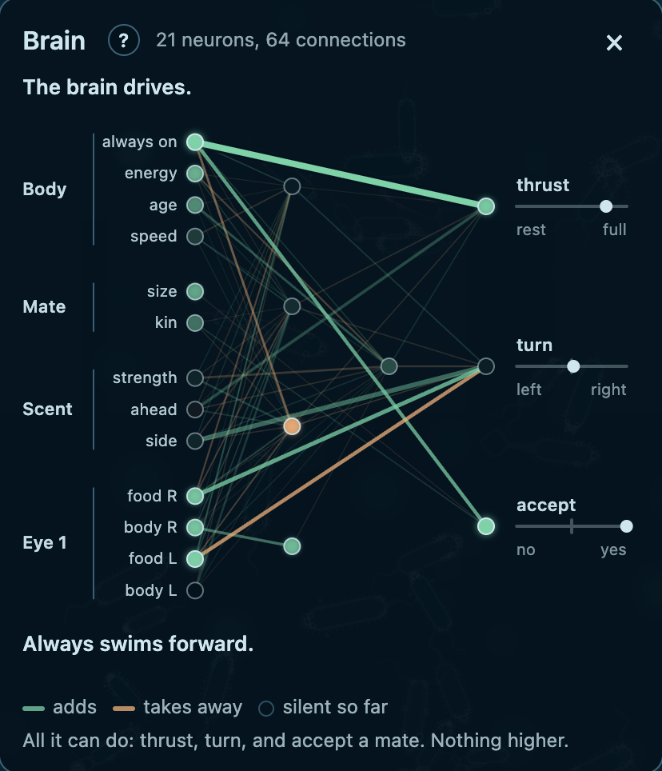
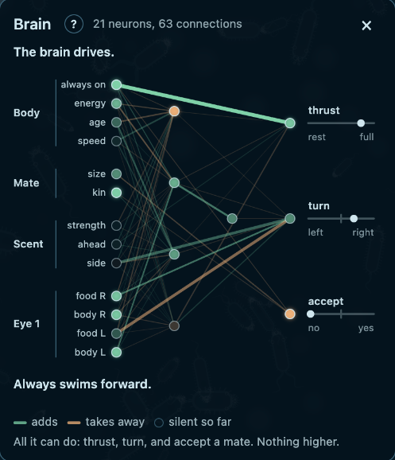
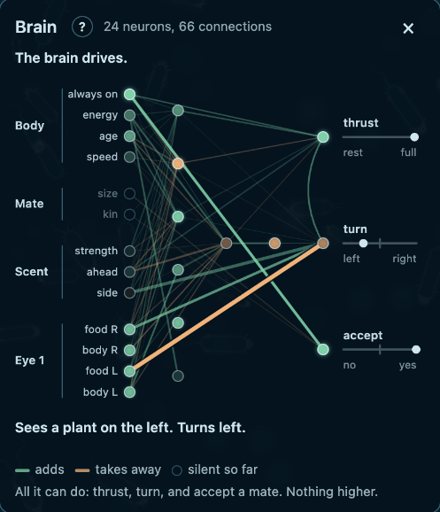
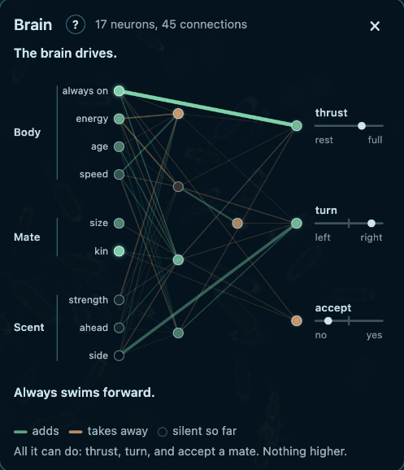
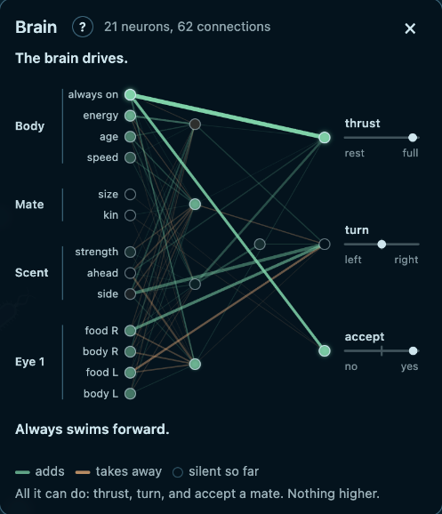
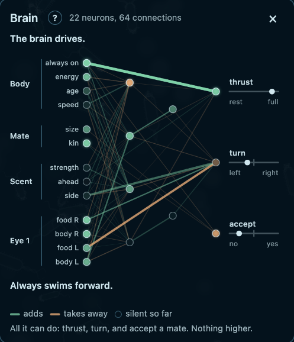

# M3 exit record

Date: 2026-10-14. Task 15 of `docs/plans/2026-10-13-m3-minds.md`. Written by the orchestrator of the
build. Every row here was run by the orchestrator on `main`, on the reference machine (Apple M4 Pro),
unless it says otherwise.

## Verdict

**What a machine can check is met, with the limits below. The owner's checks are open.** Several
choices of the build are provisional and wait for the owner (`decisions/INDEX.md`).

The roadmap's M3 exit: "brains in a long-run world differ in shape and are not all minimal (risk R1).
A player can watch their own brain while they play, let go, and see it take over."

| Clause | State | Evidence |
|---|---|---|
| Brains in a long-run world differ in shape | Met for a machine, as "evolution keeps it" | `variety` (the effective number of brain shapes) reads 15.7 to 39.1 at tick 144,000 on seeds 1, 4, 5, 6, 8. Its band fails under 2.0. A world whose brains cannot change shape reads 1.0 (`gates.md` "The brain bands") |
| They are not all minimal (R1) | Met for a machine | `hidden` (wired hidden neurons) reads 3.27 to 7.13 and `conns` 45.6 to 72.6 at tick 144,000. A world where a brain is the largest cost of a body reads 0.03 to 0.04 and 1.4 to 2.7. A founder has 4 hidden neurons and 60 connections |
| A player can watch their own brain while they play | Built. The owner's checks 1 and 3 | The brain panel draws the live graph of the possessed body, grouped by part, with the strongest path in words. Six brains drawn by it are below |
| Let go, and see it take over | Built. The owner's check 2 | The panel says "The brain drives." when the player lets go. The walkthrough teaches the step (`m3-walkthrough.md`) |

What M3 does not show:

- **"It helps" is not shown for hidden neurons.** With `hidden_gain=0` (a hidden neuron sends
  nothing) the same measures read about the same: `hidden_null` 1.67 to 4.92 against `hidden` 3.27
  to 7.13 (`m3-brains.md`, `m3-tuning.md` Part 4). The brains differ and are not minimal. That the
  hidden layer does work for the body is not measured.
- **Mating fires and evolution drops it.** 55 to 62% of births are a cross at tick 36,000. By tick
  144,000 the accept share is 0.01 to 0.24, and on seed 1 0.1% of births are a cross
  (`m3-tuning.md` Part 4).

## Gates

`make check` exits 0 (263 Vitest tests). `make gates` exits 0. Load 7.2 at the start, 4.2 at the end.

```
bench creatures=1394 median_tps=2968 floor=2400 PASS
bench-wasm creatures=1394 median_tps=2762 floor=2400 PASS
seed=1 creatures=1458 min_late=1294 plants=2229 births_late=2498 max_gen=14 mean_chemo=0.48 parked=0.00 first_bud=783 juv_starved=0.55 to_bud=0.31 PASS
seed=2 creatures=1305 min_late=1196 plants=2076 births_late=2340 max_gen=17 mean_chemo=0.46 parked=0.00 first_bud=763 juv_starved=0.54 to_bud=0.32 PASS
seed=3 creatures=1213 min_late=1152 plants=1964 births_late=2034 max_gen=14 mean_chemo=0.46 parked=0.00 first_bud=793 juv_starved=0.54 to_bud=0.31 PASS
gate-health 3/3 PASS
seed=1 creatures=1633 creatures_noscent=1513 creatures_noeye=1689 len=10.0 len_sd=1.59 parts=7.5 chemo=0.35 chemo_blind=0.16 eye=0.25 eye_blind=0.07 plans=4 speed_cv=0.25 speed=0.94 area=35.5 hidden=4.29 conns=60.0 shapes=4 shapes_raw=1 variety=30.6 PASS
seed=2 creatures=1521 creatures_noscent=1550 creatures_noeye=1540 len=9.4 len_sd=1.68 parts=8.3 chemo=0.41 chemo_blind=0.18 eye=0.26 eye_blind=0.09 plans=3 speed_cv=0.25 speed=0.90 area=33.4 hidden=4.40 conns=61.8 shapes=1 shapes_raw=0 variety=42.1 PASS
seed=3 creatures=1341 creatures_noscent=1398 creatures_noeye=1548 len=10.3 len_sd=1.61 parts=7.2 chemo=0.38 chemo_blind=0.15 eye=0.25 eye_blind=0.11 plans=3 speed_cv=0.24 speed=1.06 area=42.2 hidden=4.13 conns=58.1 shapes=3 shapes_raw=2 variety=41.1 PASS
gate-evolve 3/3 PASS
```

`make gates-long` exits 0, 5 of 5. Load 7.9 at the start, 5.3 at the end:

```
seed=1 creatures=1689 creatures_noscent=1594 creatures_noeye=1358 len=9.6 len_sd=1.23 parts=8.2 chemo=0.18 chemo_blind=0.01 eye=0.36 eye_blind=0.06 plans=5 speed_cv=0.25 speed=0.83 area=34.3 hidden=3.27 conns=46.7 shapes=4 shapes_raw=2 variety=24.9 hidden_null=4.92 conns_null=59.6 PASS
seed=4 creatures=1338 creatures_noscent=1331 creatures_noeye=1156 len=10.6 len_sd=1.53 parts=9.7 chemo=0.29 chemo_blind=0.03 eye=0.29 eye_blind=0.05 plans=5 speed_cv=0.23 speed=0.85 area=37.1 hidden=4.45 conns=62.4 shapes=3 shapes_raw=2 variety=29.9 hidden_null=4.78 conns_null=41.9 PASS
seed=5 creatures=1618 creatures_noscent=1791 creatures_noeye=1422 len=10.6 len_sd=1.44 parts=9.8 chemo=0.15 chemo_blind=0.03 eye=0.29 eye_blind=0.03 plans=6 speed_cv=0.25 speed=0.92 area=38.2 hidden=7.13 conns=72.6 shapes=5 shapes_raw=2 variety=23.1 hidden_null=1.67 conns_null=28.5 PASS
seed=6 creatures=1437 creatures_noscent=1349 creatures_noeye=1208 len=9.9 len_sd=1.53 parts=9.0 chemo=0.20 chemo_blind=0.04 eye=0.30 eye_blind=0.06 plans=4 speed_cv=0.28 speed=0.92 area=35.4 hidden=4.11 conns=45.6 shapes=2 shapes_raw=1 variety=39.1 hidden_null=4.70 conns_null=52.4 PASS
seed=8 creatures=1246 creatures_noscent=1314 creatures_noeye=1168 len=10.1 len_sd=1.56 parts=10.5 chemo=0.14 chemo_blind=0.00 eye=0.36 eye_blind=0.05 plans=6 speed_cv=0.25 speed=0.77 area=39.7 hidden=4.92 conns=61.6 shapes=6 shapes_raw=5 variety=15.7 hidden_null=4.45 conns_null=54.9 PASS
gate-evolve 5/5 PASS
```

These rows equal the build agent's close digit for digit. The long gate ran before the `speed_cv`
band was added. The band reads only `speed_cv`, which these rows print at 0.23 to 0.28.

## Throughput

| Reading | Ticks per second | Load |
|---|---|---|
| WASM in Node (the gate), M3 at stage 1 (mixing off), 1,357 creatures | 2,898 to 3,023 | 2.8 to 4.9 |
| WASM in Node, the M3 defaults (mixing on), 1,394 creatures | 2,646 to 2,801 over nine readings | 2.6 to 8 |
| The same, in `make gates` for this record | 2,762 | 7.2 to 4.2 |

The target of M3 is 2,600 since 2026-10-14, down from 2,700: with mixing on, three trials left the
bench on the line (`m3-tuning.md` Part 4). The owner chose this. The floor of 2,400 holds. Mixing
costs about 9%: more bodies and the crosses, not larger brains.

## Brains

Six brains drawn by the viewer from the world of seed 1 at tick 36,000
(`public/m2-world.tdpl`, baked at these defaults: `tick=36000 creatures=1633 plants=2229
hash=7d220c2a`). Each is a body with a store over 0.6, under 0.6 of its life, and full-grown, at a
different place in the world.








The orchestrator's reading: 17 to 24 neurons and 45 to 66 connections. Brain 4 has no eye gene, so
it has no eye group. Five of six say "Always swims forward.": the strongest path is the constant
input to thrust. One says "Sees a plant on the left. Turns left." This is one look by the builder,
not the owner's check 3.

The world of tick 144,000 is `public/m2-world-long.tdpl` (`tick=144000 creatures=1689 hash=45892934`).
Both files load in the page with no console error. They keep the names of M2 because the look
instructions of `m3-shapes.md` open them by those names. They are not in git.

`probe-brains --seed 1 --ticks 144000` (load 4.3):

```
seed=1 tick=144000 creatures=1689
seed=1 hidden min=0 q1=2 median=3 q3=4 max=8 mean=3.27
seed=1 hidden_genes min=0 q1=3 median=4 q3=6 max=9 mean=4.21
seed=1 conns min=6 q1=25 median=49 q3=66 max=119 mean=46.65
seed=1 variety=24.9
seed=1 shape hidden_genes=2 core_conns=10 share=0.09
seed=1 shape hidden_genes=4 core_conns=24 share=0.08
seed=1 shape hidden_genes=6 core_conns=33 share=0.08
seed=1 shape hidden_genes=4 core_conns=19 share=0.06
seed=1 shape hidden_genes=7 core_conns=34 share=0.04
seed=1 shape hidden_genes=5 core_conns=24 share=0.04
seed=1 shape hidden_genes=3 core_conns=14 share=0.03
seed=1 shape hidden_genes=3 core_conns=13 share=0.03
seed=1 wired body=1.00 mate=0.95 scent=0.82 eye=1.00 accept=0.01
```

`hidden` counts the hidden neurons with a way in from an input and a way out to an output.
`hidden_genes` counts every hidden gene. The `wired` row is the share of bodies with a connection over 0.1
in size from each group of inputs. `accept=0.01`: 1% of bodies accept a mate at tick 144,000.

After the audit (finding M2), the long gate also prints the variety of shapes counted on wired
neurons only:

| Seed | 1 | 4 | 5 | 6 | 8 |
|---|---|---|---|---|---|
| `variety` (every hidden gene) | 24.9 | 29.9 | 23.1 | 39.1 | 15.7 |
| `variety_wired` (wired hidden neurons only) | 24.9 | 21.8 | 19.1 | 38.5 | 12.2 |

Unwired genes raise `variety` by up to 27%. The clause "brains differ in shape" holds on either
reading.

## Found on the way

- **A quarter of the bodies of an evolved world cannot be possessed.** In the world at tick 36,000,
  390 of 1,631 bodies have under a quarter of a full store and 32 are old: 26% of clicks are refused.
  The median store is 0.40. Two clicks of the orchestrator in a row were refused. This is a felt
  judgment for the owner, not a measured fault.
- **The commit message of `f4d2ef3` says the bench is over 2,700.** The readings after it do not
  support that (`m3-tuning.md` Part 4).

## The audit

A fresh-context `auditor` ran at `77a096e` (`m3-audit.md`). No High finding in the code. Its one High
finding was a gap in the record: the rows of `make gates` at the final defaults were written nowhere.
They are now in `m3-tuning.md` "Close" and above. Each of the four M3 bands still rejects its bad
input at the defaults, 0/3, and the long gate matches the record digit for digit. Removing the
connection term of the upkeep fails 3 tests. What was fixed and what is carried is at the end of
`m3-audit.md`.

## Open problems, sorted by who decides

**The owner, provisional choices of the build** (`decisions/INDEX.md`, each marked "provisional,
owner to confirm"):

| Date | Choice | Where |
|---|---|---|
| 2026-10-13 | The three brain bands of the long gate. `variety` replaced the band on `shapes` | `gates.md`, `m3-brains.md`, `m3-tuning.md` Part 3 |
| 2026-10-13 | The walkthrough is built from twelve principles of the research, and its eight open questions are answered for the build | `m3-walkthrough.md` |
| 2026-10-13 | The default draw of a body stays as it was. Four looks wait behind `?look=1` to `?look=4`, and the owner picks one or none | `m3-shapes.md` |
| 2026-10-14 | Stage 1 of the retune closes with `mut_conn_remove` 0.01 | `m3-tuning.md` Part 3 |
| 2026-10-14 | `mix_rate` stays a parameter | `decisions/INDEX.md` |
| 2026-10-14 | No band on area or on `plans`, the egg range as it is, and a band on `speed_cv` at 0.10 | `m3-tuning.md` Part 5, `gates.md` |

**New for the owner:** should the `variety` band read `variety_wired`? Both pass on 5 of 5 seeds
and both read 1.0 in the frozen world. The wired reading does not count genes that do nothing.

**Decided by the owner on 2026-10-14:** mixing on, `fixed_upkeep` 0.037, and a throughput target of
2,600.

**Carried to M4.**

- Mating is a feature of a young world: evolution drops the accept answer by tick 144,000.
- A cross brings donor hidden genes that stay unwired and still pay upkeep: 4.2 to 6.6 hidden genes
  against 3.3 to 3.9 wired at tick 144,000.
- "It helps" is shown for no M3 rule. The world with blind eyes holds fewer creatures on 5 of 5 seeds,
  consistent with "it helps" for eyes, each arm evolved alone.
- Lines with no chemoreceptor still take over on some runs (seed 5 at 0.30).
- The strongest path is the constant drive in most bodies, so the sentence in words says the same
  thing for most of them.
- Throughput has a margin of about 6% over its target of 2,600.
- Constants in rule code that are tunable by role and not in the parameter table: 14 groups
  (`m3-audit.md` step 6). `architecture.md` §5.6 says this is not yet true.
- `no_chemo` in the census counts a body with no chemoreceptor part. A chemoreceptor of size 0 has
  no scent input and is not counted (audit L15).
- A child's genome, history ids, and cross draws are drawn before the parent is known to pay (audit
  L16, known since M2).
- The `speed_cv` band has its proof run and no unit test (audit L14).

## Owner checks

Not done by an agent. Run `make dev` in `tidepool/` and open the page it prints.

1. Play with the brain panel open (key B). Does it make sense with no instructions?
2. Let go. Can you see the moment when the brain takes over?
3. Is the sentence about the strongest path true to what the body does?
4. Court a creature (key C, with a body in touch). Do you know what the card compares, and why it
   said yes or no?
5. Open `/?world=/m2-world-long.tdpl`. Can you tell bodies apart by their shape now? Try
   `&look=1` to `&look=4` (`m3-shapes.md`). (M2 check 1)
6. Possess a body with no eyes. Is the dimmed world fair, or only annoying? (M2 check 3)
7. `/?bench` on a phone and on a slower laptop. (M2 check 4)
8. The four felt judgments of `m1-feel.md`. (M2 check 5)
9. The walkthrough with a person who has not seen the game (`m3-walkthrough.md`, the playtest
   script).
