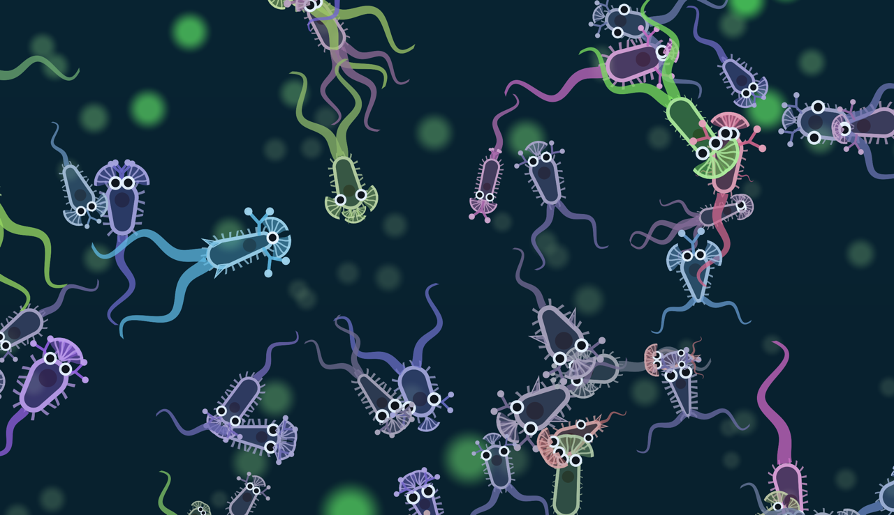
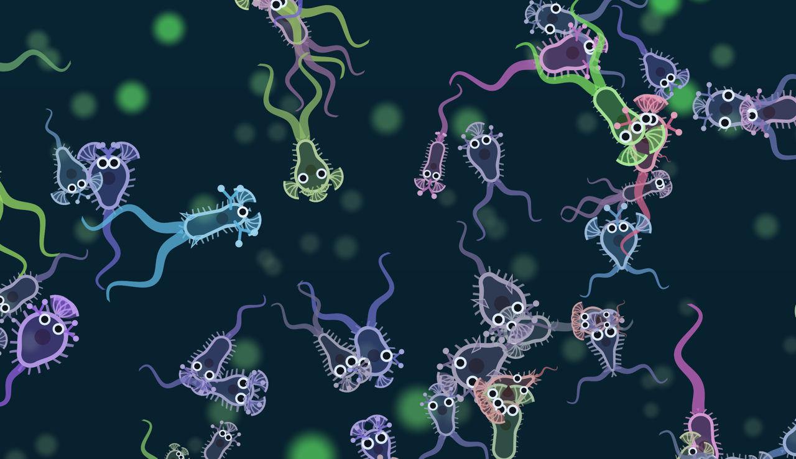
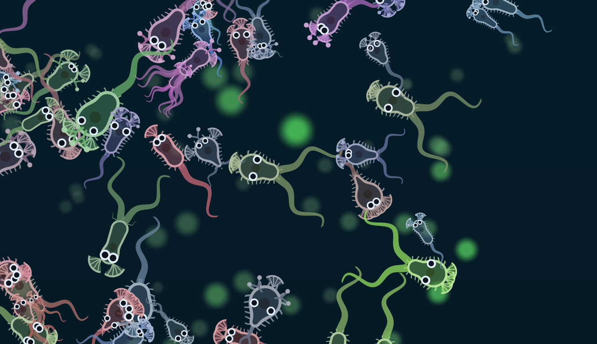
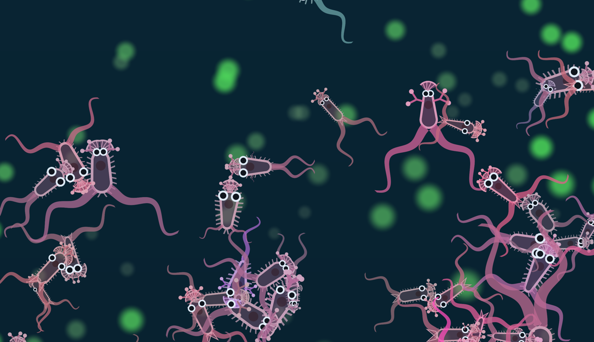
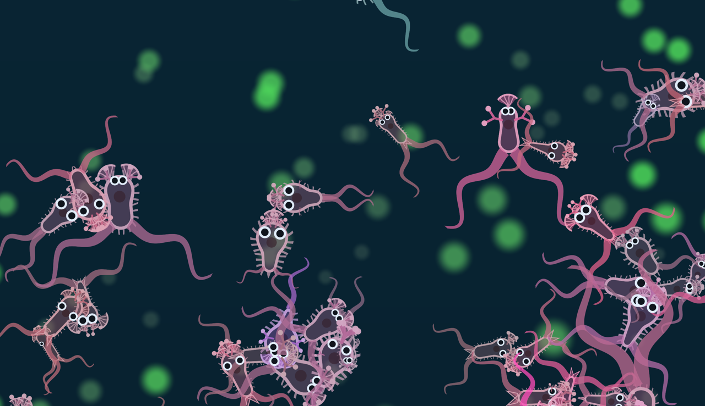
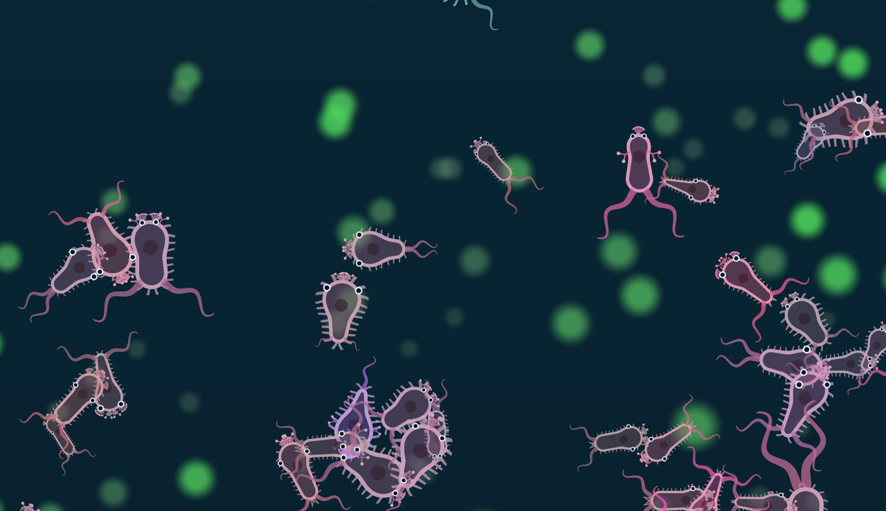

# M3 Task 14: three looks for the outline of a body

Date: 2026-10-13. Draw only. No gene, no rule, no file under `crates/`. **The owner picks one look or
none. Until then the default draw is today's, and `?look=1`, `2`, `3`, or `4` selects a look.** Each
number below comes from the part genes in the frame record.

**Look 4 was built after the owner saw looks 1 to 3. It is at the end of this file, and it is the
one to look at first.**

The text from "How each look is computed" to "Judgment" is the build agent's. The orchestrator looked
at patch a in looks 0, 1, and 3 and agrees with what it says of them. The orchestrator did not run
the timings again.

## How each look is computed

**Look 1, the taper.** Each part has a lever: its size times the cosine of its anchor angle. That is
+1 at the nose, 0 at the middle and -1 at the tail. The positive levers sum to `nose` and the negative
ones to `tail`. Each end is scaled by the other end of a founder, so a founder is level:
`front = nose × founder tail`, `back = tail × founder nose`. The lean is
`(front − back) / max(front + back, the founder's sum)`. The floor makes a body that carries little
taper little. The lean divided by `TAPER_FULL` (1/4) and held in -1 to 1 is the taper. The lighter
end narrows, down to `NARROWEST` (0.35) of the width at a full taper, and the other end keeps the
width gene. The outline is the hull of the two round ends. Parts sit on the narrowed outline.

**Look 2, the parts.** Look 1, and every part draws at 2 times today's size (`LOOK_2_SIZE`). The mouth
is a solid fan that opens out of the body, with bristles and a bright lip. The chemosensor is a stalk
that forks, with a knob on each tip. Flagellum, fin and eye keep today's shape.

**Look 3, the swell.** Look 2, and each mouth adds a circle on the body axis at the mouth's place
along the body. Its radius is the half width of the outline there times `1 + 0.5 × mouth size`
(`MOUTH_SWELL`). The circle joins the outline smoothly. The mouth sits on the surface of its swell. A
body swells at its first 4 mouths (`MAX_SWELLS`). The baked world has 3 at most.

In every look, a body shorter than 14 pixels on screen (`PART_LOD_PX`) keeps today's outline, the same
rule as its parts and cilia. The shape pops at that zoom.

`parts.ts` holds a copy of the founder's parts (`FOUNDER`), because the taper is measured against a
founder. A test reads `genome.rs` and `params.rs` and fails if the copy drifts.

## The pictures

Baked world `m2-world.tdpl` (seed 1, tick 36,000), paused, overlay hidden. Window 1280 × 739 CSS
pixels, 7 pixels per world unit. The files are saved at 1280 pixels wide. About 25 bodies are on
screen in each patch. Camera centres: a (571, 353), b (731, 633), c (1291, 293).

| Patch | Look 0 (today) | Look 1 | Look 2 | Look 3 |
|---|---|---|---|---|
| a |  |  |  |  |
| b |  |  |  |  |
| c |  |  |  |  |

To see them live: bake the world as `/HANDOFF.md` says, `make dev`, and open
`/?world=/m2-world.tdpl&look=3`.

## Look 0 is today's draw

16 frames (4 zooms, 2 clocks, with and without lineage, possessed and budded marks) were drawn with
the old sources and the new ones, and the pixels read back. 0 bytes differ of 7.5 M per frame. Looks 1
to 3 differ, so the check is not empty. It ran in Watch only.

## Bench

`/?bench` reads the worker, not the draw. It does not tell the looks apart.

| Look | `/?bench` ticks per second, 1,356 creatures | Frame interval, median / p95 | Load average |
|---|---|---|---|
| 0 | 3,228 | 8.3 ms / 10 ms | 5.89 |
| 1 | 3,193 | 8.3 ms / 10 ms | 5.84 |
| 2 | 3,147 | 8.3 ms / 9.9 ms | 6.04 |
| 3 | 3,230 | 8.3 ms / 10 ms | not read |

The display runs at 120 Hz and every look holds it.

The draw itself was timed as one `draw` plus a GPU sync, on the paused baked world. Each figure is the
median of 16 rounds of 100 draws, with the four looks taking turns. Load average 5.6 to 6.5.

| View | Bodies in the frame | Look 0 | Look 1 | Look 2 | Look 3 |
|---|---|---|---|---|---|
| Whole world, scale 0.72 | 1,448 | 1.29 ms | 1.32 ms (+3%) | 1.45 ms (+12%) | 1.67 ms (+29%) |
| Scale 2 | 253 | 1.13 ms | 1.19 ms (+6%) | 1.43 ms (+27%) | 1.60 ms (+42%) |
| Patch a, scale 7 | 73 | 0.62 ms | 0.65 ms (+4%) | 0.79 ms (+27%) | 0.99 ms (+59%) |

**Finding: looks 2 and 3 are more than a tenth over look 0 in draw time, which is the limit of the
plan.** Look 1 is inside the limit in this run. A shorter first run at the same load read look 1 at
+11% on the whole world, so its margin is not proven. The added cost of look 3 is 0.4 ms of an 8.3 ms
frame on this machine. A phone and a slower laptop are not read. The cost has not been profiled. A
part twice the size covers 4 times the pixels, and look 3 runs a 4-step loop in each body pixel.

## Judgment

**Look 0.** Capsules that differ in size and colour. The parts are thin lines at this zoom. This is
what the owner described.

**Look 1.** A teardrop reads apart from a capsule. In each patch only a minority of the bodies shows a
clear taper, and the rest still read as capsules. They were not counted. The cause is the world, not
the draw: on 1,333 bodies the lean was -0.15 at the 10th percentile, 0.05 at the median and 0.22 at the
90th. Evolved bodies keep the founder's layout, with the mouth at the nose and the flagellum at the
tail. Alone, look 1 answers the owner's request only halfway.

**Look 2.** Part lists read at a glance. One fan against two, a fork, and eye pairs are clear. Three
things read badly:
- Flagella at twice the size are 1.5 to 2 body lengths long and thick. They cross other bodies, and a
  cluster becomes a tangle (patch c on the right, patch b at the top left).
- Eyes at twice the size read as cartoon eyes. That is a change of tone.
- Fins are small in this world (size 0.27 at most) and read as spikes.

**Look 3.** The strongest change. The body itself has a shape: a pear, a bulb, a top. Mouth size shows
as head width. Three limits:
- Most mouths sit at the nose (about 1,500 of 1,907 at anchor 0.15 or less), so nearly every body gets
  a swollen head. The bodies differ from look 0 more than they differ from each other.
- Eyes and feelers at the nose sit inside the swell, not on its edge.
- It carries the flagella tangle of look 2.

**The build agent's pick: look 3, with the flagellum back at today's size.** It is the only look where
the outline stops being an oval for nearly every body, and the fans and forks of look 2 do the work of
telling part lists apart. Before it becomes the only look, find where the added draw time goes and cut
it. If the eyes are too much, look 1 plus the swell with parts at today's size is a fourth option. It
is not built.

## Not checked

- Play mode in any look: the energy ring and the dimmed world.
- A fresh founder world in any look.
- The shape pop at the 14-pixel threshold.
- Draw time on a phone or a slower laptop.

## Look 4: the scale of look 1 with the detail of look 3

The owner on looks 1 to 3, 2026-10-13: "I'm not sure what look I prefer actually. I feel like there
is an optimal look to this that we just can't quite get yet. I like the look of look one, a little
bit smaller creatures overall and thinner lines. But I kinda like the complexity and detail we seem
to get with a bit of the look three. But overall look one in terms of scale for sure."

**How it is computed.** The taper of look 1 (`TAPER_FULL` 1/4, `NARROWEST` 0.35). Every part at
today's size: `LOOK_2_SIZE` is not applied. The fan for a mouth and the fork for a chemoreceptor, with
the shader constants of look 3. Each mouth swells the outline by `1 + MOUTH_SWELL × size`, with
`MOUTH_SWELL` 0.5 as in look 3. Mouths at one place on the axis share the largest swell, and a body
takes 2 places (`LOOK_4_SWELLS`). In the baked world 2 of 1,448 bodies have a third place. New in this
look: a part inside a swell sits on the edge of the swell. In look 3 the eyes and feelers sat inside
the head.

| Patch | Look 1 | Look 3 | Look 4 |
|---|---|---|---|
| a |  |  |  |
| b |  |  |  |
| c |  |  |  |

**Draw time.** Median of 32 rounds of 100 draws, looks 0 and 4 in turns, three runs at a load average
of 10.7 to 14.2. Another agent's simulation and a virtual machine were running, and look 0 itself
moved from 1.2 to 2.9 ms between runs.

| View | Bodies | Look 4 over look 0, by run |
|---|---|---|
| Whole world, scale 0.72 | 1,448 | +8.5%, +2.6%, +4.1% |
| Scale 2, centre (571, 353) | 389 | +7.4%, +10.4%, +8.1% |
| Patch a, scale 7 | 73 | +2.0%, +4.2%, +1.9% |

Two runs just before these, at a load of 11.7 to 12.3, read +7.8% and +17.3% on the whole world and
+11.8% and +13.5% at scale 2. **So the limit of a tenth is not proven for look 4: it reads near the
limit on a loaded machine, and it needs one reading on a quiet one.** It is far under looks 2 and 3.
Three costs were found and cut on the way: an array of swells in the shader (now one vector), the
outline worked out on every draw (now kept by slot and worked out again when the uid, the length, or
the width changes), and pixels far from the outline (now discarded, with the same picture).

**The build agent's judgment.** Reads well: bodies and lines are at the scale of look 1, and the
outlines are pears, bulbs, and slim capsules. Head width shows mouth size. No tangle of flagella and
no cartoon eyes. It is clearly more to read than look 1. Reads badly: a fan or a fork is about 6 CSS
pixels, so you can see that a body has one but can hardly count one fan against two at 25 bodies on
screen. In patch c one lineage dominates and the bodies look alike. Most mouths sit at the nose, so
most bodies are pears. Tried and dropped: a swell of 0.35 read too close to look 1, and a wider fan
merged a pair into one cap. No fin shape was added: a fin here is at most 5 CSS pixels.

The orchestrator looked at patch a and agrees: it is the scale of look 1 and the bodies no longer
read as ovals.

**Not checked for look 4:** Play mode (the energy ring, the lineage outline, the dimmed world), a
fresh founder world, the shape pop at 14 pixels, a phone or a slower laptop. One risk in the code: the
kept outline trusts that a uid names one body. A second world loaded under the same renderer could
show a stale outline for a body with the same uid, length, and width.

## What waits for the owner

1. Pick look 1, 2, 3, 4, or none. After the pick the other looks and `?look` are deleted
   (`../plans/2026-10-13-m3-minds.md`, Task 14). To see look 4 live: bake the world, `make dev`, and
   open `/?world=/m2-world.tdpl&look=4`.
2. Looks 2 and 3 break the plan's limit on draw time. Look 4 reads near it on a loaded machine. The
   picked look gets one reading on a quiet machine and on a phone before the others are deleted.

## Decided

The owner picked look 4 on 2026-10-15. It is now the only draw of a body. Looks 0 (the draw of M2),
1, 2, and 3, the `Look` type, `lookOf`, `?look`, and the `LOOK` define of the shaders are deleted in
the commit that adds this section. The pictures and numbers above stay as the record of the choice.

Still open: the draw time of look 4 on a quiet machine and on a phone. Owner check 7 of
`m3-exit.md` asks for `/?bench` on a phone and on a slower laptop. `/?bench` reads the worker, not
the draw (see "Bench"), so the draw needs its own reading too.

Checked by the orchestrator at `a1d1ef5`: `/?world=/m2-world-long.tdpl` on a fresh port draws the
long world with the tapered outlines and the part marks, and the console holds no error or warning.
No test compiles GLSL, so this was the first compile of the shaders without the `LOOK` define.
